# "Kelping Hands" — Yao Wang

Source: https://yaowang.cargo.site/Kelping-Hands  
Backed up: 2026-11-12

## Text

This is a reaserch driven project focus on

exploring and designing

 a food regenerative system

based on the Rhode Island area.

Fall, 2022

Group project with Gary Li and Helen Chen

Website design for the project.

## Images

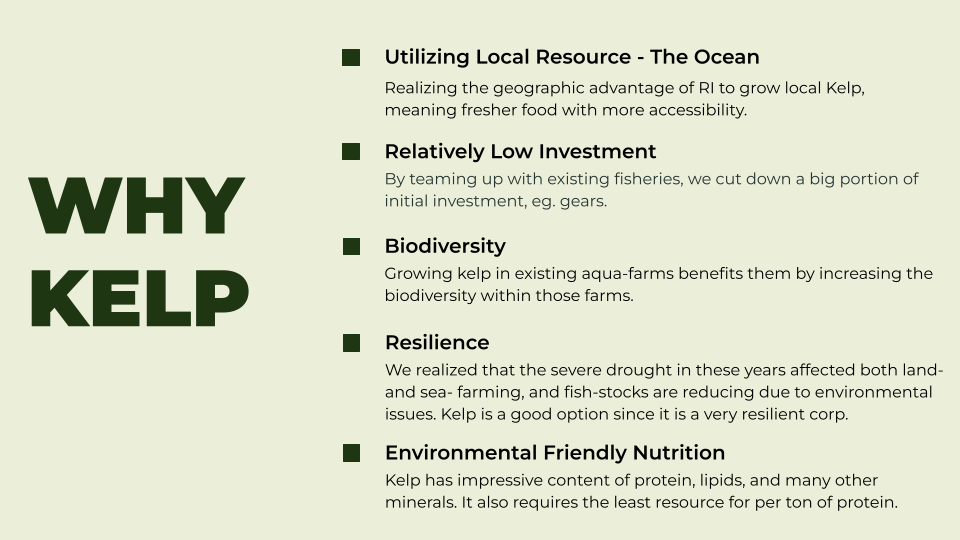
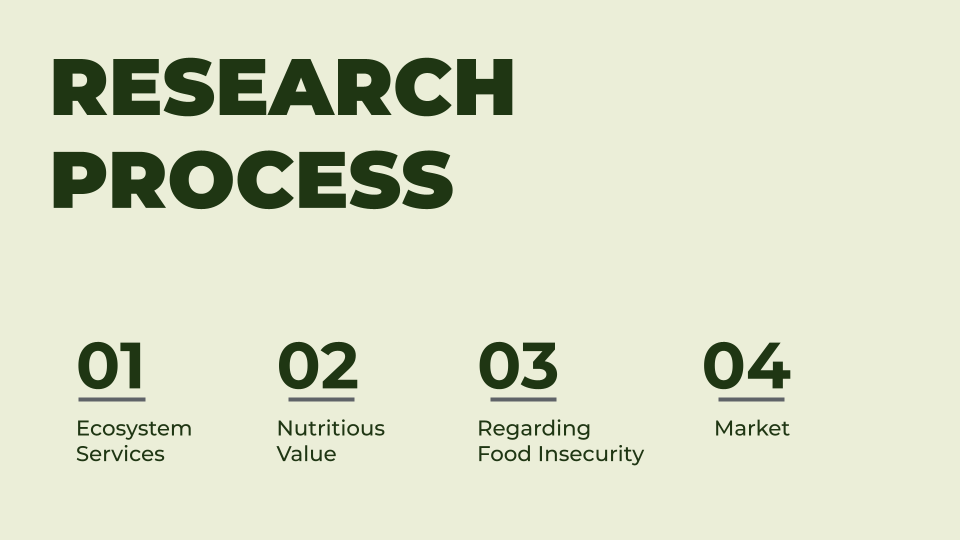
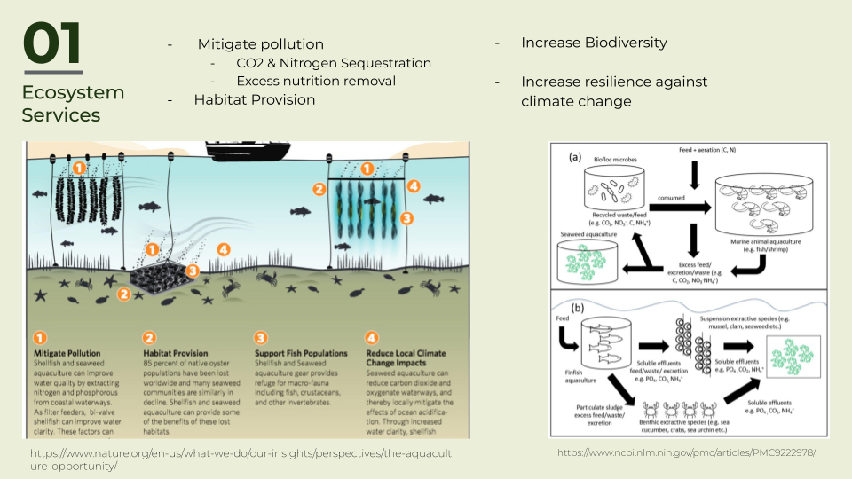
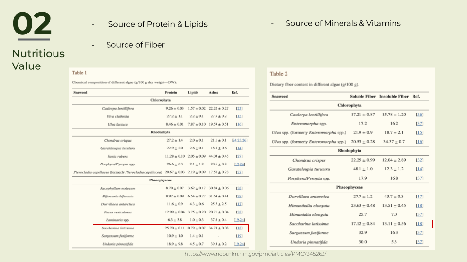
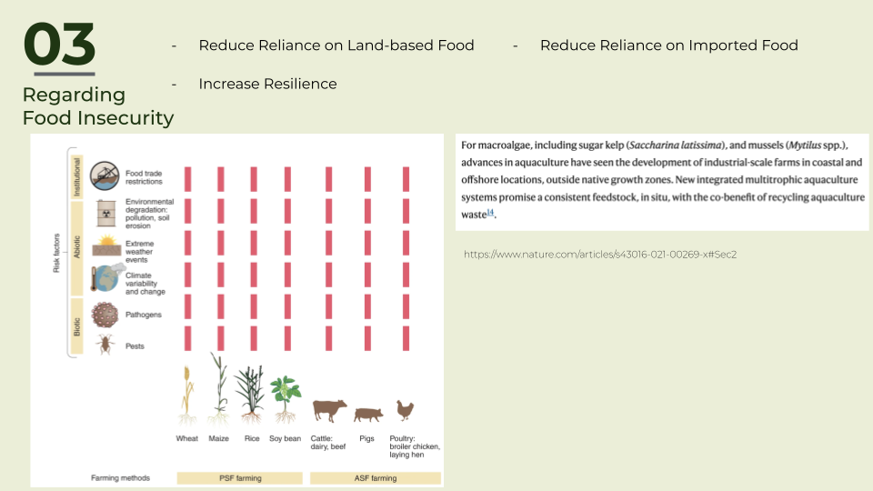
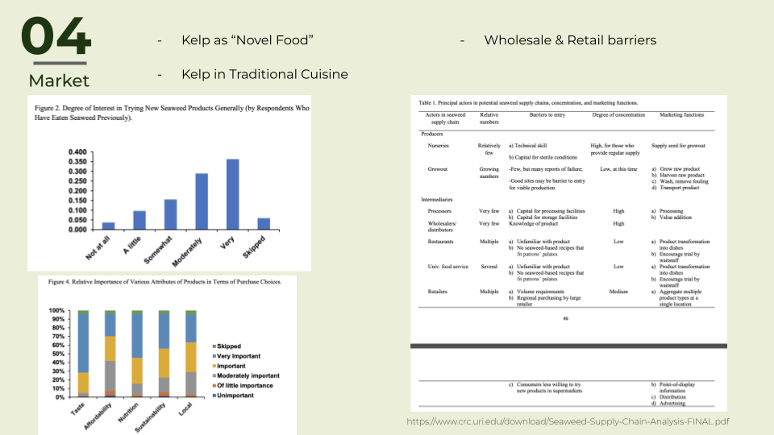
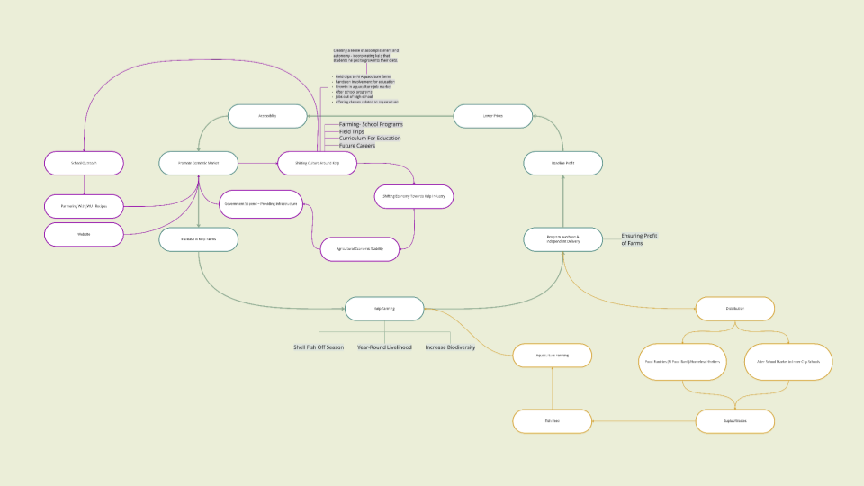
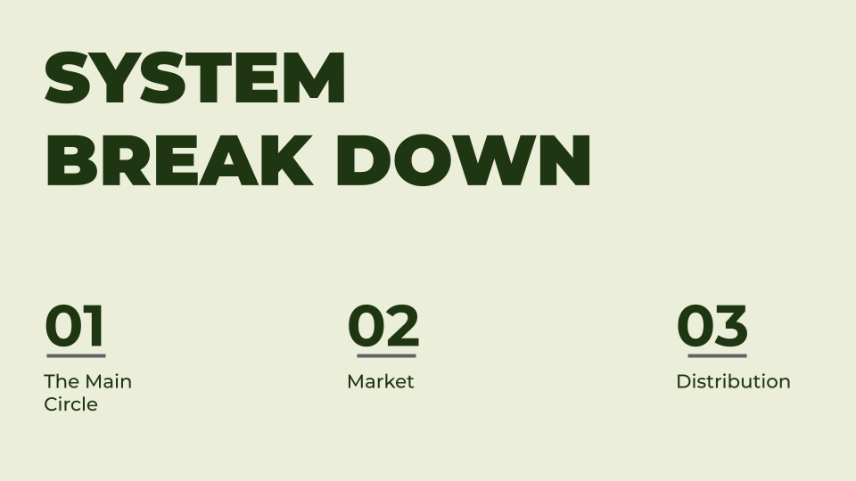
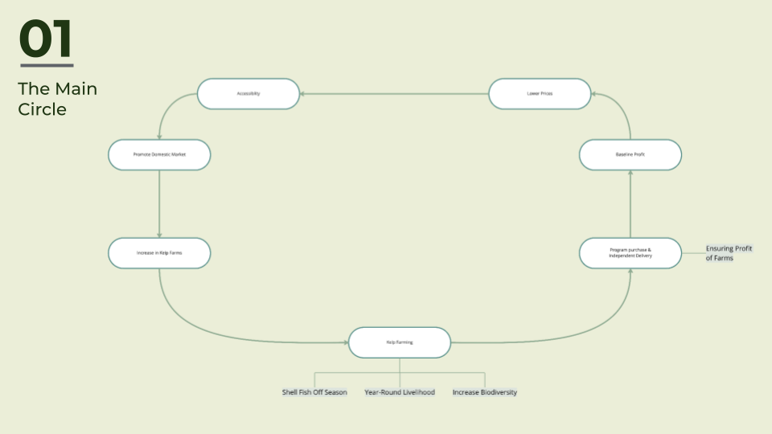
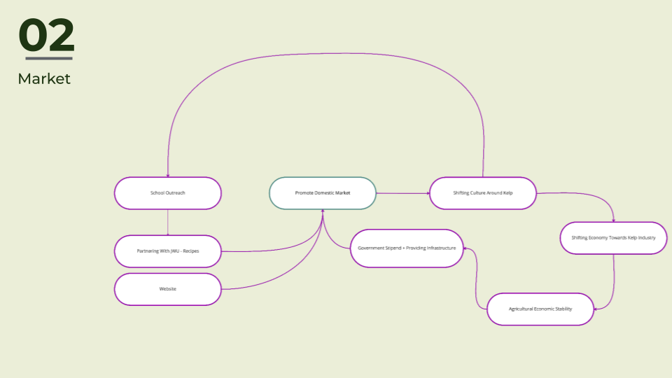
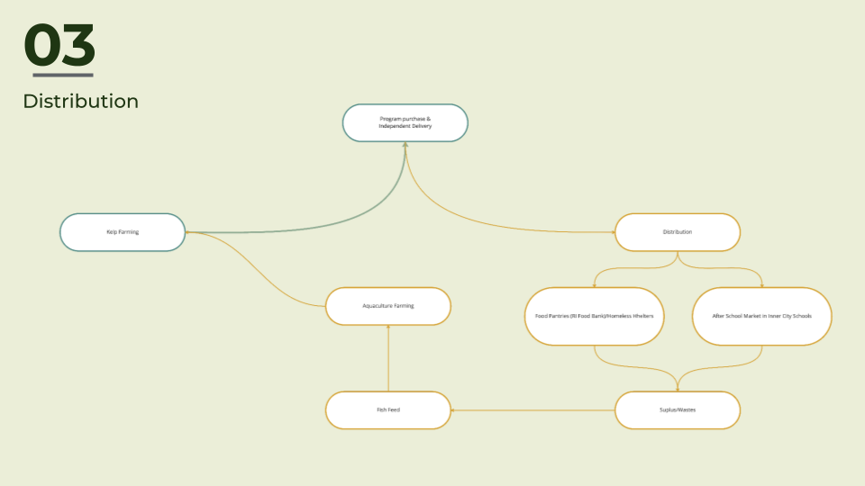
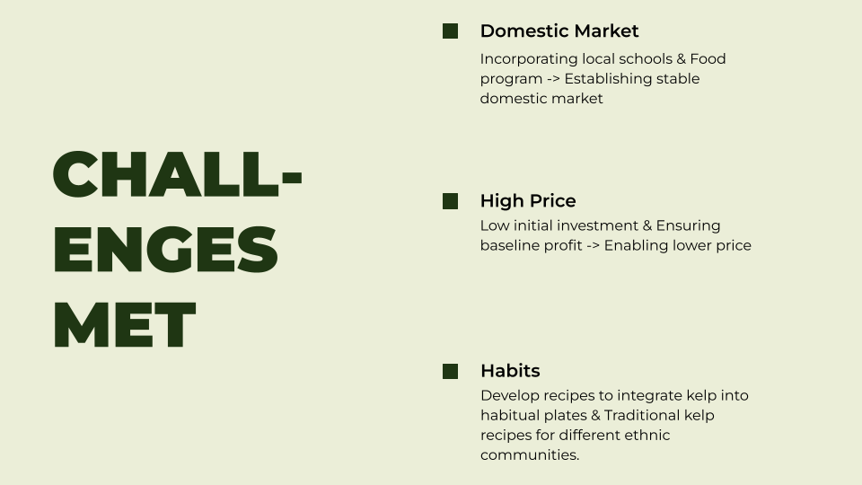
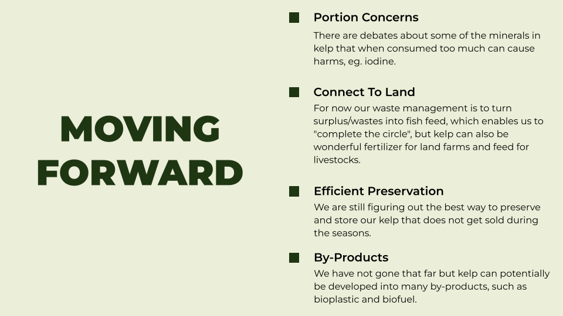
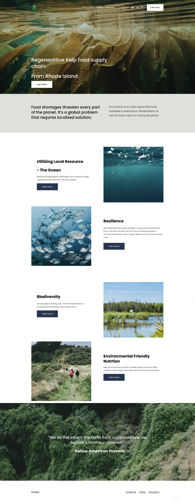
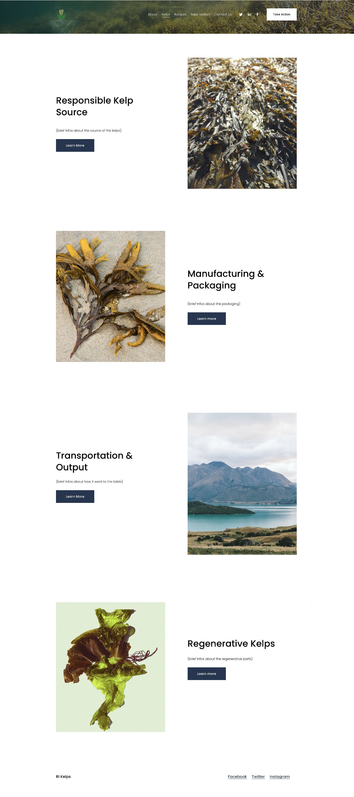
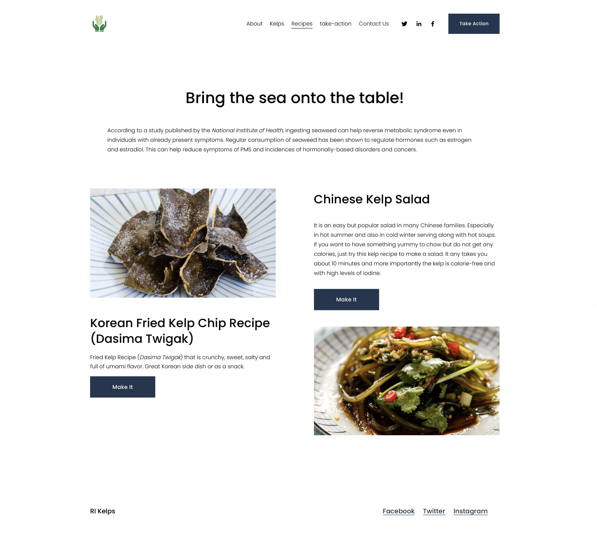
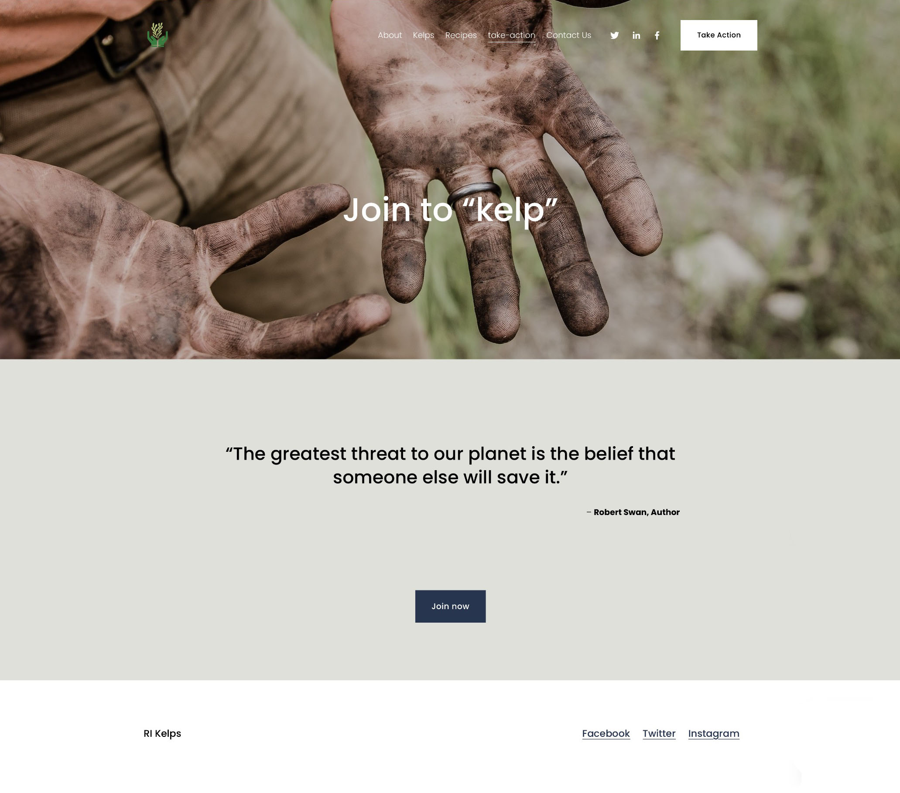

## Links

- [Resume](#)
- [︎](http://www.linkedin.com/in/yao-wang-risd)
- [︎](https://medium.com/@yolaaadaw)
- [#](#)
