# ROOTY — Yao Wang

Source: https://yaowang.cargo.site/ROOTY  
Backed up: 2026-11-12

## Text

This study proposes ROOTY, a sugarcane-mycelium furniture solution.

Date: Fall,2022

Problem 

Nowadays, furniture recycling holds significant importance as individuals tend to replace their furniture rather than repair it.

(source:clf.org) <http://clf.org>

Solution

Mycelium is biodegradable and sugarcane bagasse is an abundant organic leftover, making it ideal for furniture.

Since mycelium is decomposable, and sugarcane bagasse is one of
the most abundant organic leftovers, it is an ideal material for
furniture manufacturing.

Mycelium, bagasse, and dried shredded ginger create a new material with a smoother, more appealing surface and fragrance than normal mycelium, which smells.

ROOTY specializes in offering furniture made from mycelium derived from sugarcane, such as this lamp shaped like ginger.

If the mycelium shell of the lamp becomes damaged, or scratched, or the user wants to dispose of it, they can easily break it apart  by twisting and turning it, then discard the mycelium shell in their garden and recycle the electronics. The lamp's structure features an easy-break point that facilitates the removal of the electronics.

ROOTY also offers a "grow your own lamp kit" that includes dehydrated material and molds, enabling users to grow their own furniture parts.

Material Choice

Experiments

This recipe was developed through experimentation with various materials, testing their strength and durability, as well as examining their surface appearance.

## Images

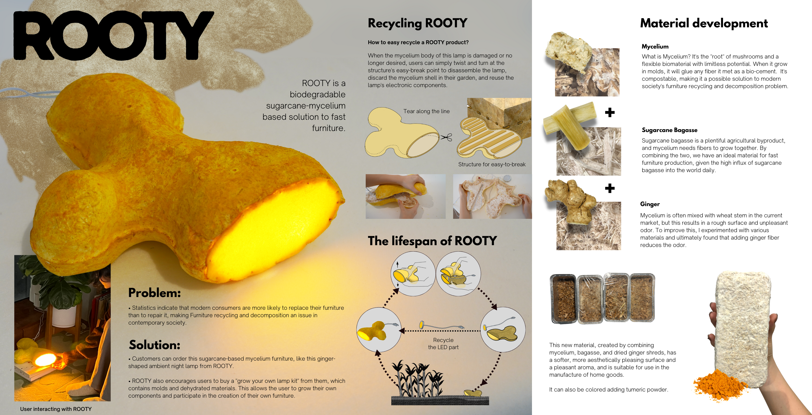
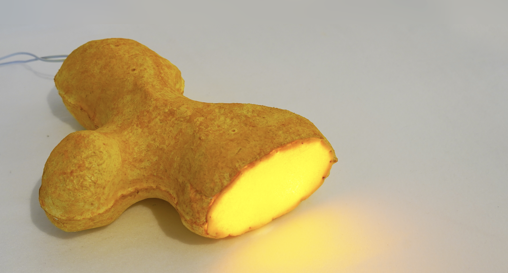
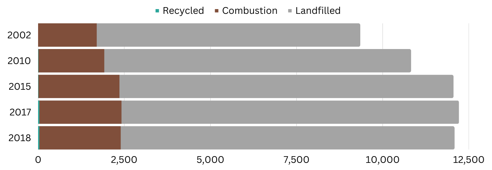
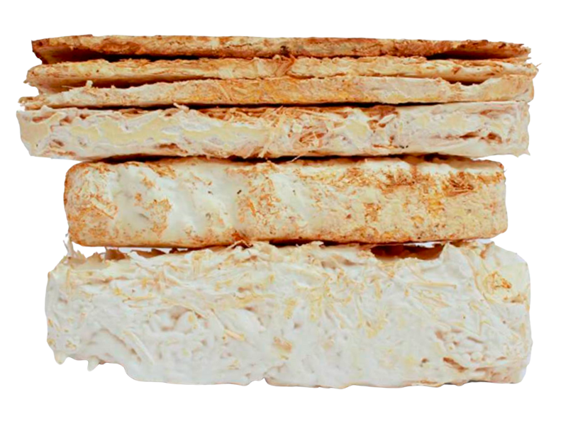
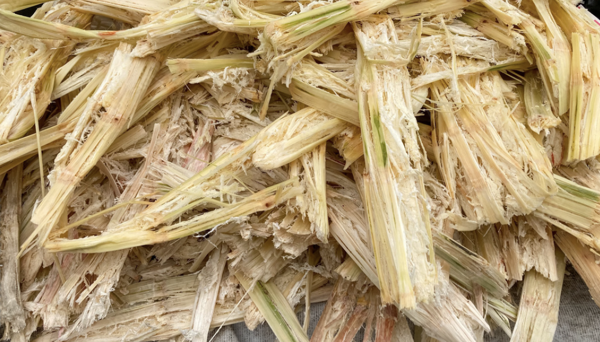
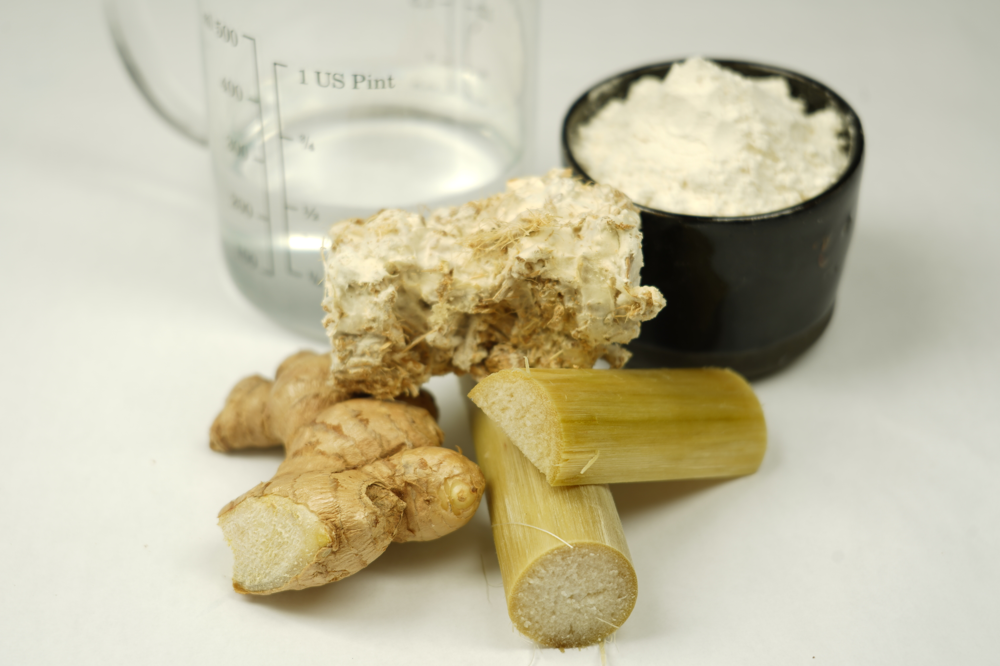
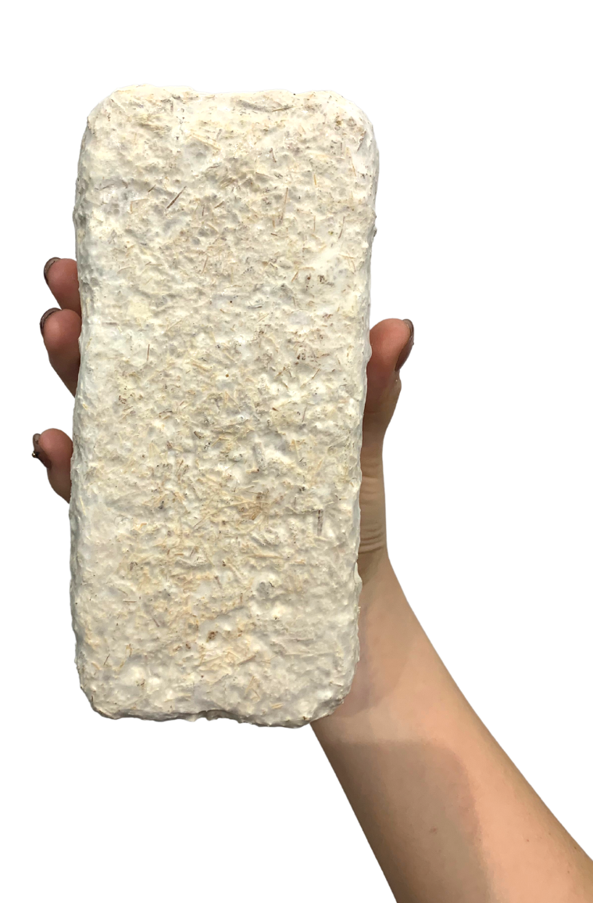
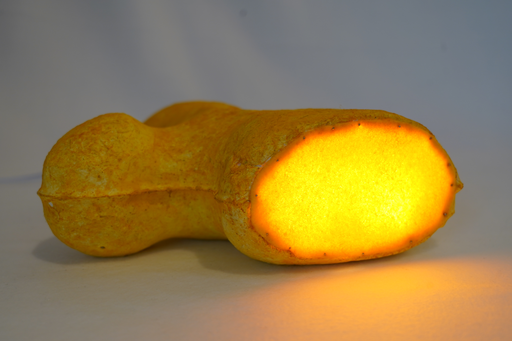
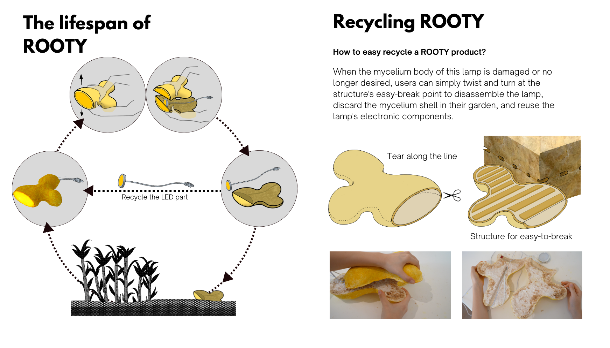
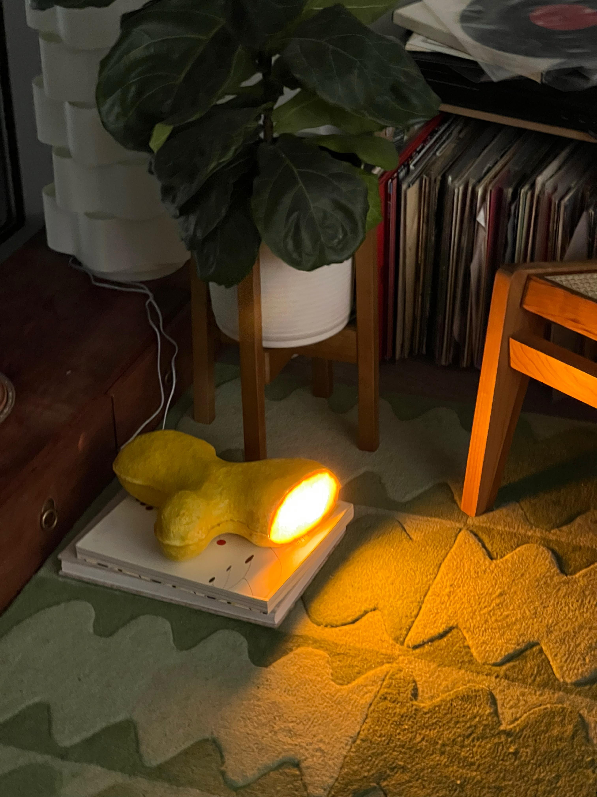
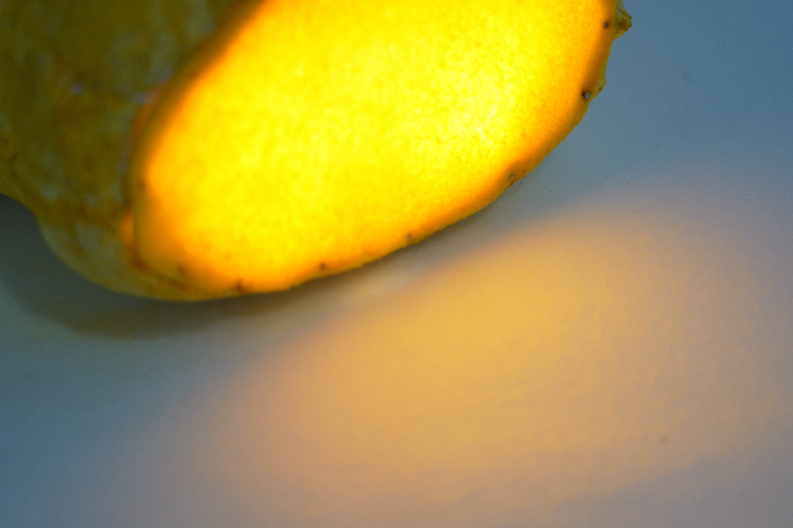
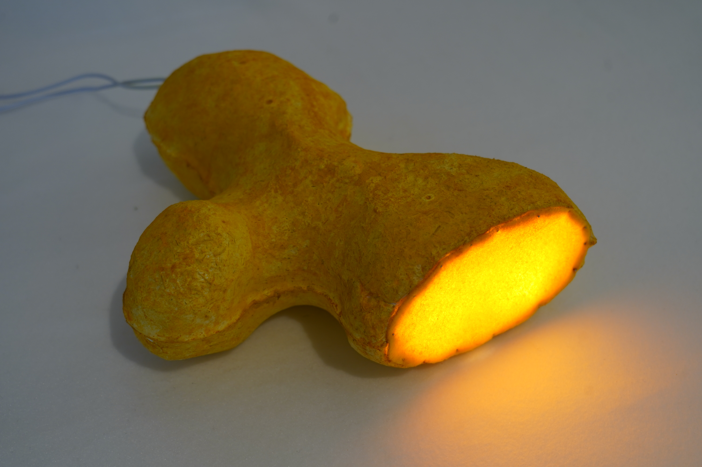
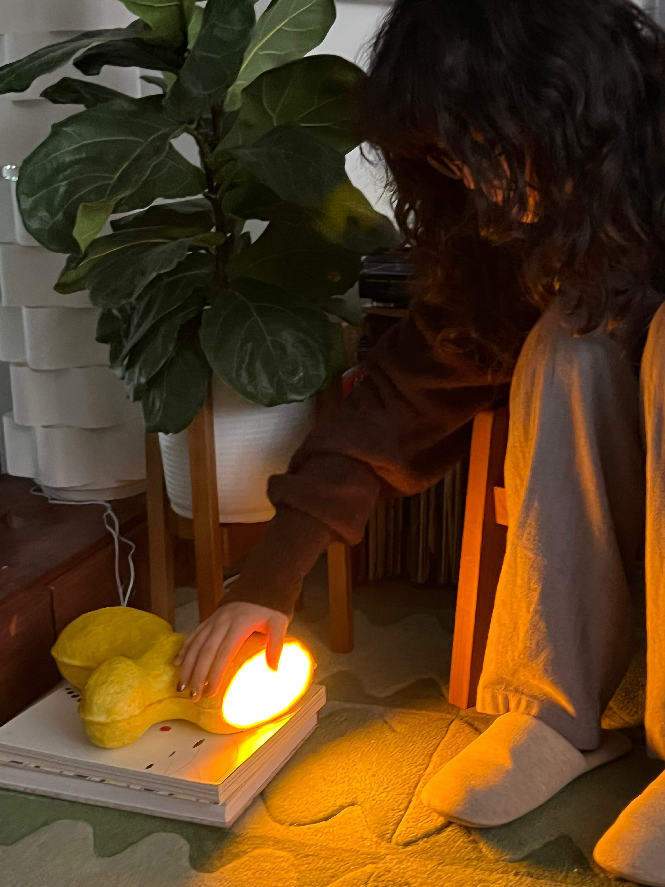
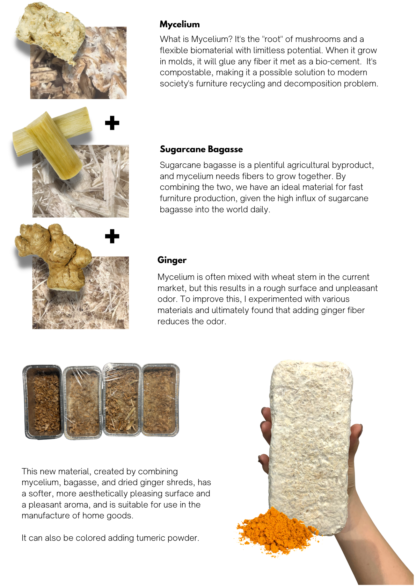
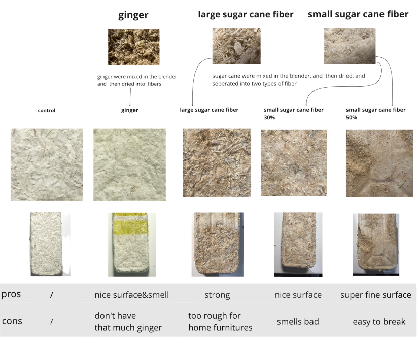
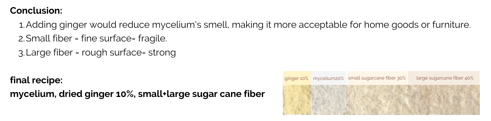

## Links

- [Resume](#)
- [︎](http://www.linkedin.com/in/yao-wang-risd)
- [︎](https://medium.com/@yolaaadaw)
- [#](#)
- [clf.org)](http://clf.org)
