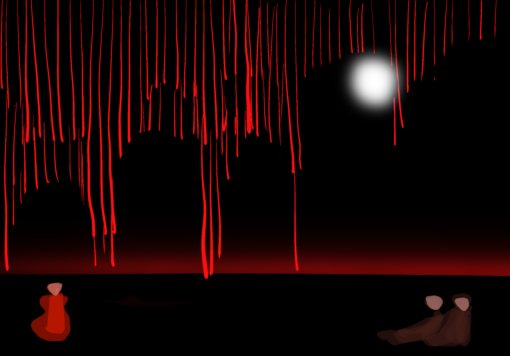
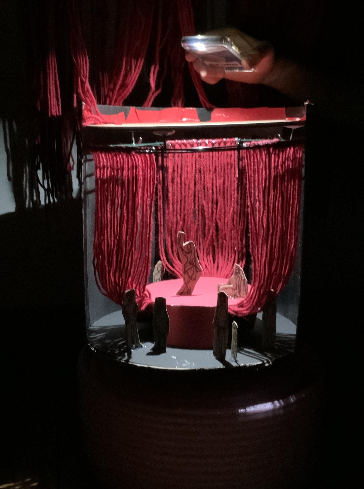
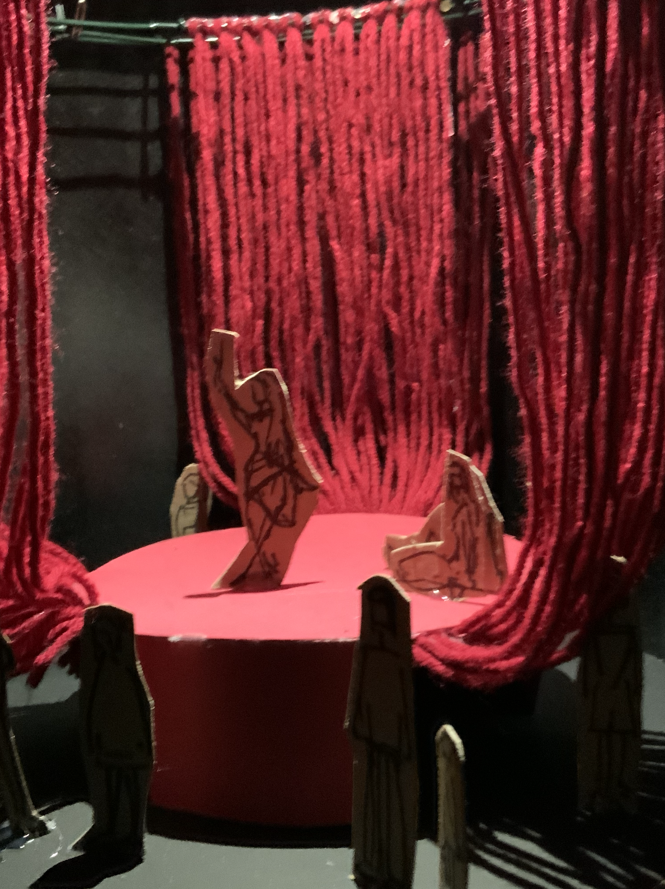
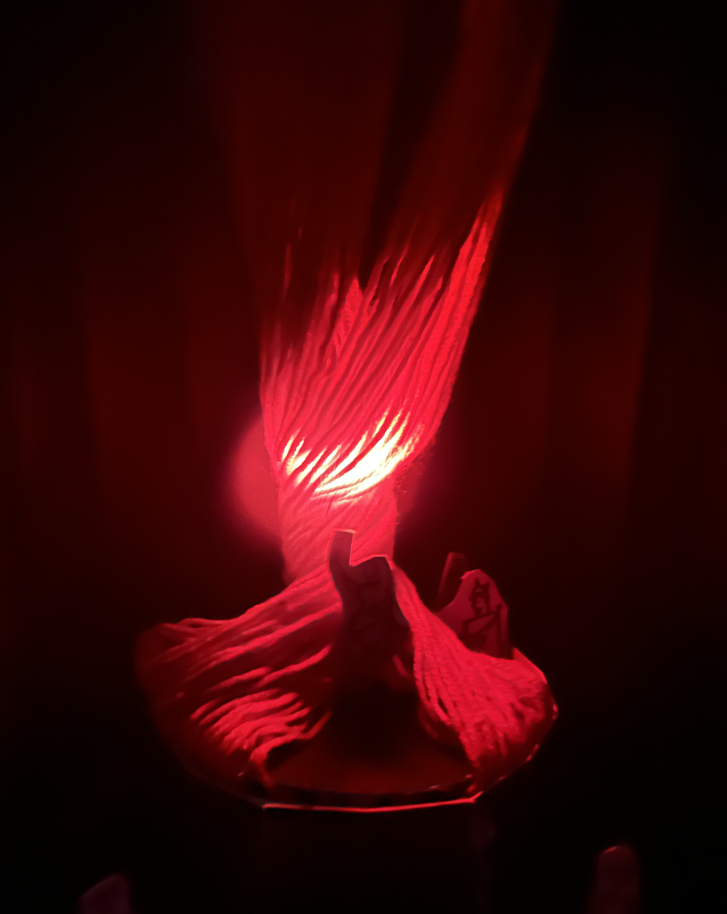
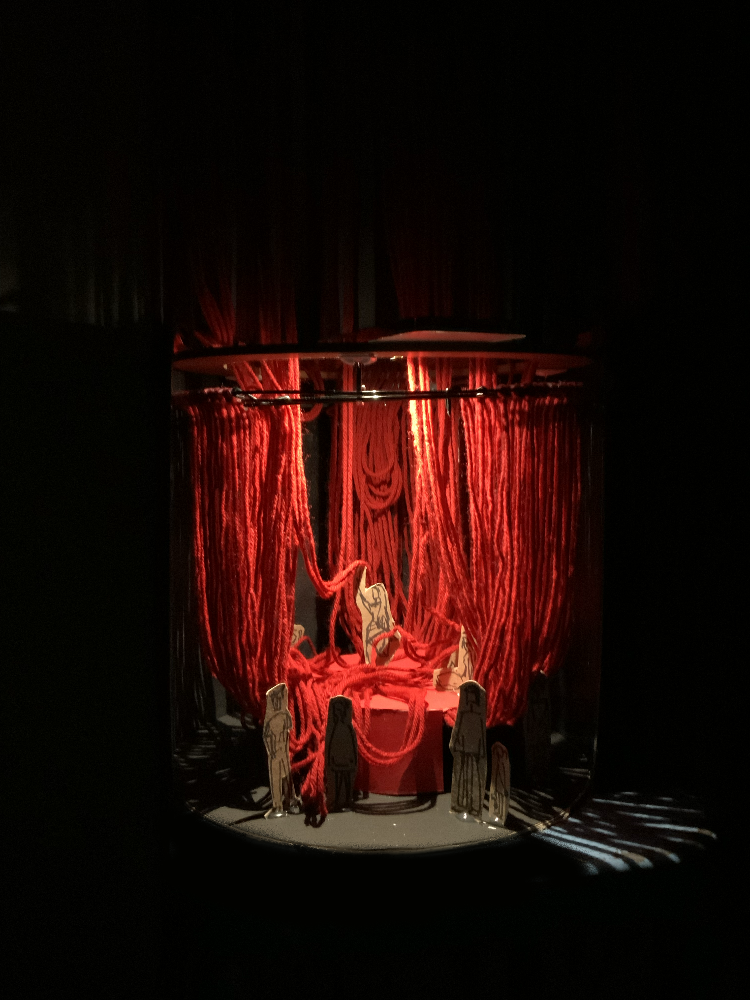
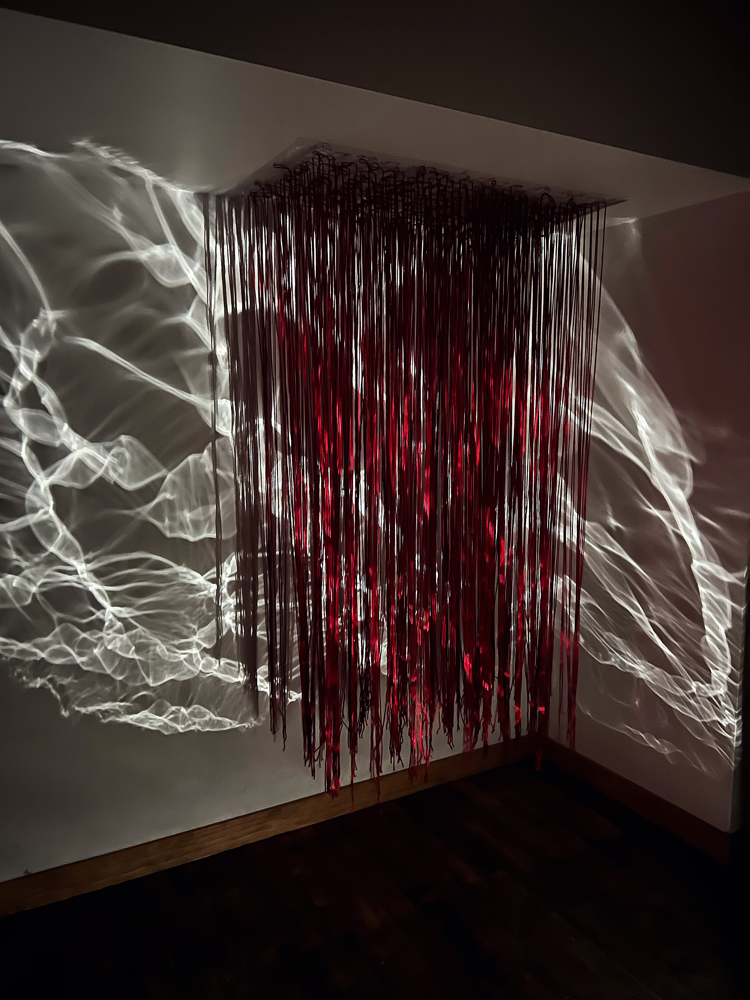
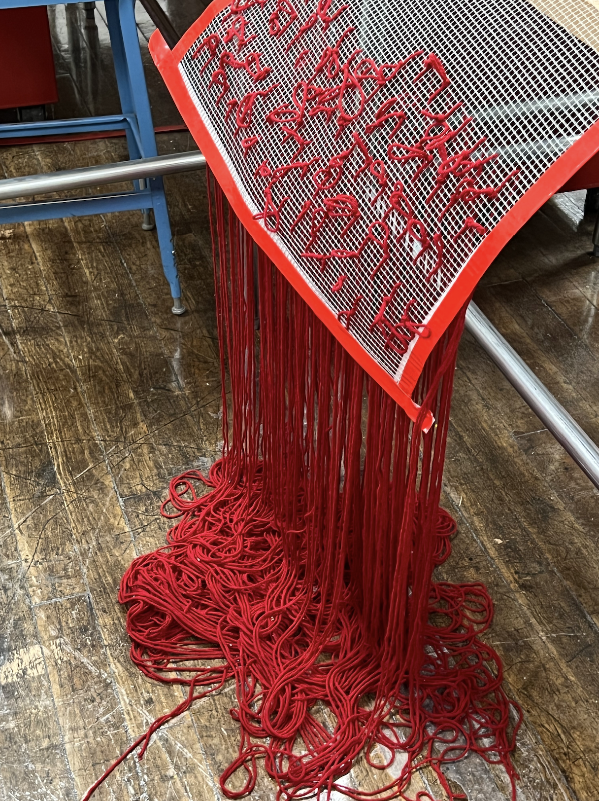

# Salome — Yao Wang

Source: https://yaowang.cargo.site/Salome  
Backed up: 2026-11-12

## Text

Stage Design for the one-act tragedy Salome by Oscar Wilde

Spring, 2022
Material: cord, wireframe, lightning equipment, cardboard

[click here for the complete synopsis of Salome] <https://en.wikipedia.org/wiki/Salome_(play)#Synopsis>

“....
Herod asks Salome to dance for him. She refuses, but when he promises to give her anything she wants, she agrees. Ignoring her mother's pleas – "Ne dansez pas, ma fille" – "Do not dance, my daughter"

– Salome performs the dance of the seven veils <https://en.wikipedia.org/wiki/Dance_of_the_seven_veils> .”

“Delighted, Herod asks what reward she would like, and she asks for the head of Jokanaan on a silver platter. Horrified, Herod refuses, while Herodias rejoices at Salome's choice. Herod offers other rewards, but Salome insists and reminds Herod of his promise. He finally yields. The executioner descends into the cistern, and Salome impatiently awaits her reward. When the prophet's head is brought to her, she passionately addresses Jokanaan as if he were still alive and finally kisses his lips:

Ah! j'ai baisé ta bouche, Iokanaan, j'ai baisé ta bouche. Il y avait une âcre saveur sur tes lèvres. Était-ce la saveur du sang? ... Mais, peut-être est-ce la saveur de l'amour. On dit que l'amour a une âcre saveur ... Mais, qu'importe? Qu'importe? J'ai baisé ta bouche, Iokanaan, j'ai baisé ta bouche.

Ah! I have kissed thy mouth, Jokanaan, I have kissed thy mouth. There was a bitter taste on thy lips. Was it the taste of blood? ... But perchance it is the taste of love. ... They say that love hath a bitter taste. ... But what of that? what of that? I have kissed thy mouth, Jokanaan.

Herod, frightened and appalled at Salome's behavior, orders the soldiers, "Tuez cette femme!" – "Kill that woman!", and they crush her to death under their shields.”

// The prototype of part of the scene

## Images

## Embedded media

- [video-output-5313A82C-D848-46BB-A672-2CC61E77ED40.MOV](video-output-5313A82C-D848-46BB-A672-2CC61E77ED40.MOV) (local copy; original https://files.cargocollective.com/c1646262/video-output-5313A82C-D848-46BB-A672-2CC61E77ED40.MOV)

## Links

- [Resume](#)
- [︎](http://www.linkedin.com/in/yao-wang-risd)
- [︎](https://medium.com/@yolaaadaw)
- [#](#)
- [[click here for the complete synopsis of Salome]](https://en.wikipedia.org/wiki/Salome_(play)#Synopsis)
- [dance of the seven veils](https://en.wikipedia.org/wiki/Dance_of_the_seven_veils)
