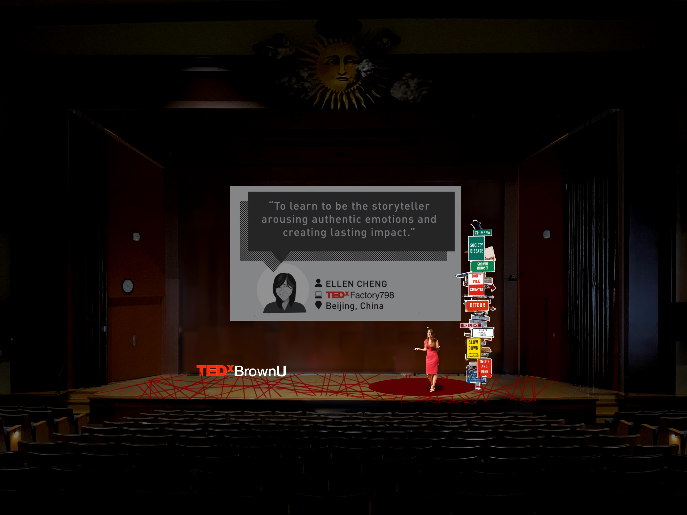
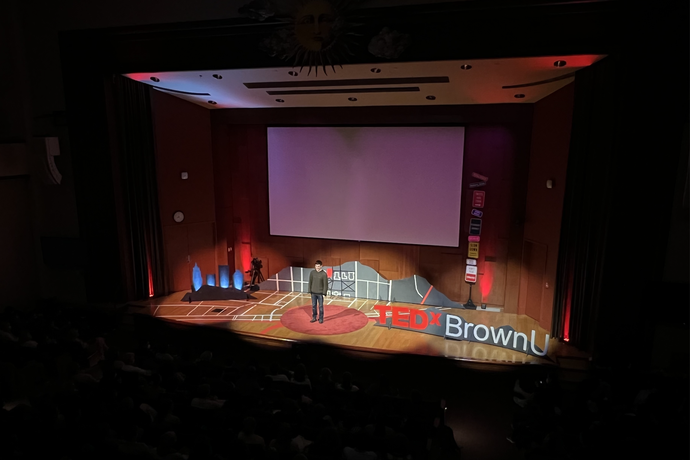
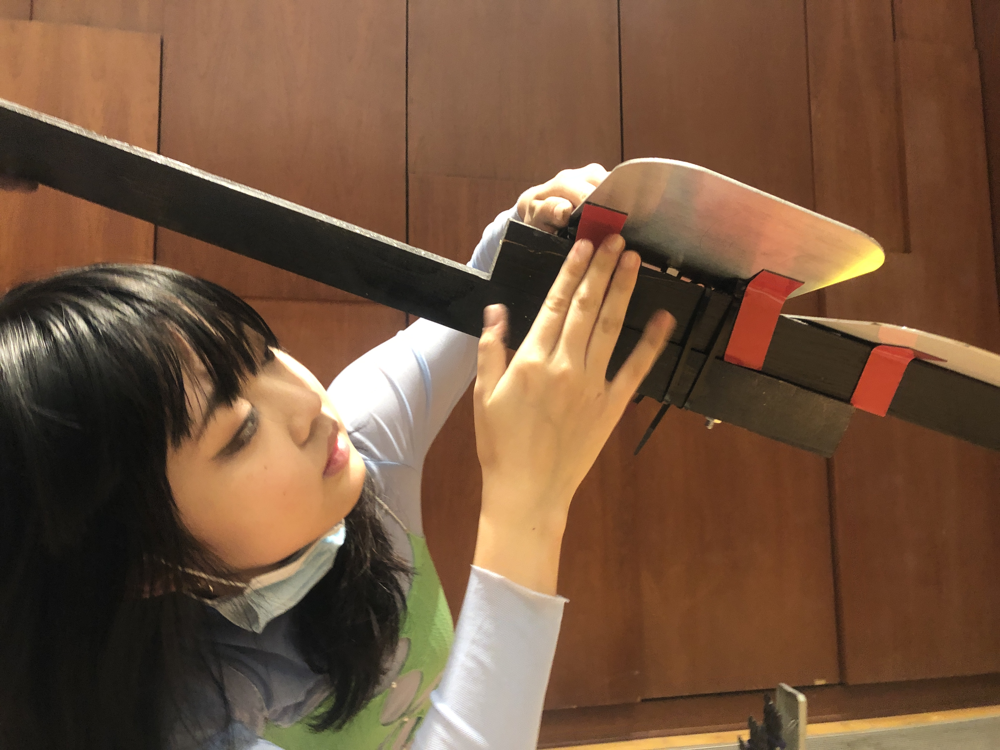
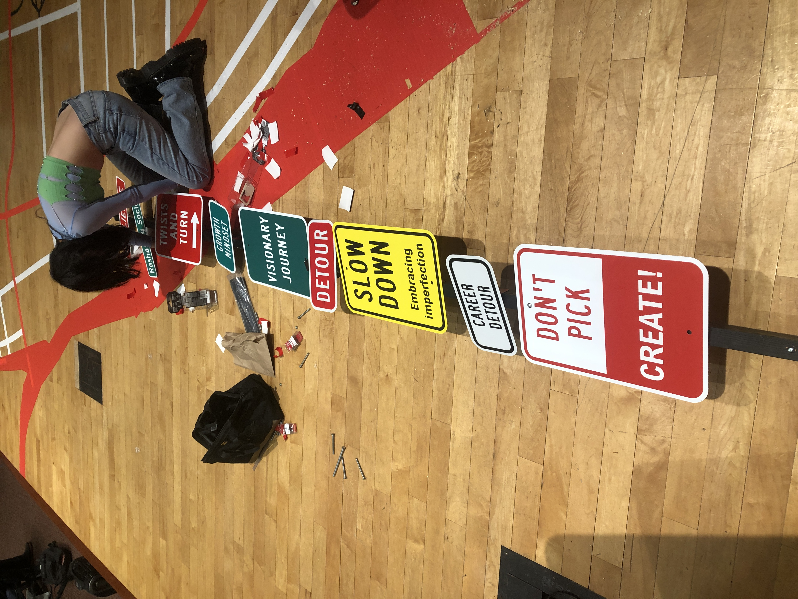

# Tedx Brown University 2021<Detours> — Yao Wang

Source: https://yaowang.cargo.site/Tedx-Brown-University-2021  
Backed up: 2026-11-12

## Text

[click here for more information about this event] <https://www.ted.com/tedx/events/49529>

This event occurred on March 10, 2022, in Providence, Rhode Island
United States

Theme: Detours

Group project with the TEDx Brown U team

Spring 2022

the sketch for the stage design

the outcome

## Images

## Links

- [Resume](#)
- [︎](http://www.linkedin.com/in/yao-wang-risd)
- [︎](https://medium.com/@yolaaadaw)
- [#](#)
- [https://www.ted.com/tedx/events/49529](https://www.ted.com/tedx/events/49529)
- [[click here for more information about this event]](https://www.ted.com/tedx/events/49529)
